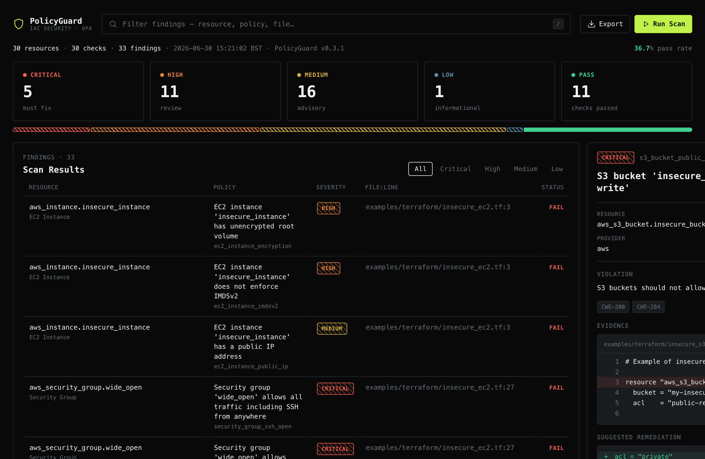
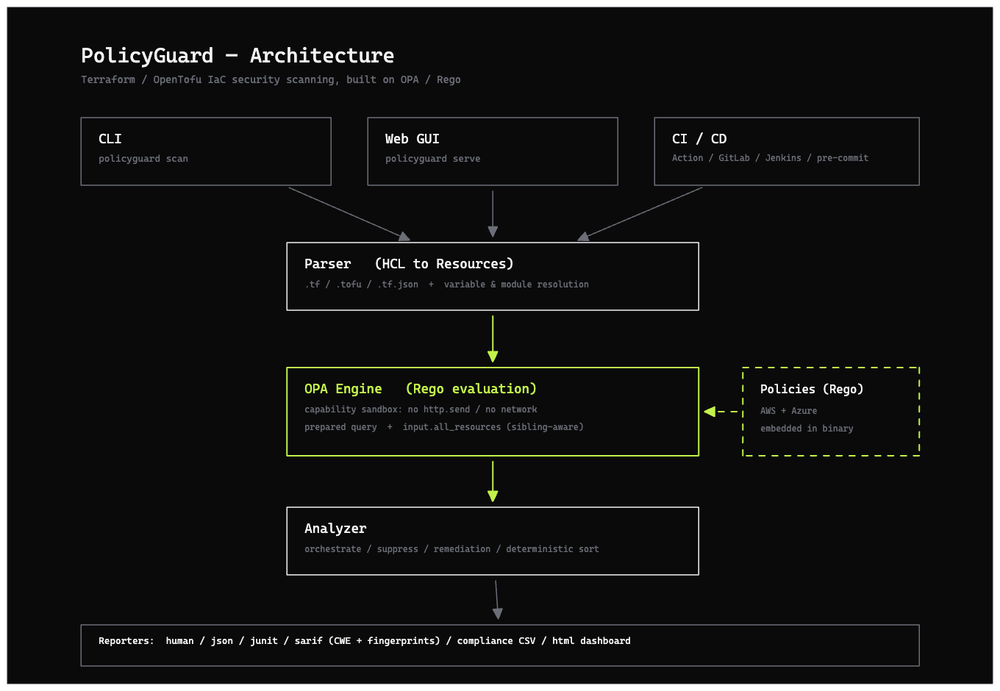

<p align="center">
  <picture>
    <source media="(prefers-color-scheme: dark)" srcset="docs/design/lockup-dark.svg">
    
  </picture>
</p>

<p align="center">
  <b>Catch the Terraform/OpenTofu misconfigurations that matter — before they reach the cloud.</b><br>
  An open, auditable IaC security scanner built on OPA/Rego, with a measured precision you can actually gate a pipeline on.
</p>

<p align="center">
  
  
  
  
</p>

PolicyGuard evaluates every resource in your Terraform/OpenTofu against security
policies written in **Rego** (Open Policy Agent). Every finding traces to a policy
you can open and read, carries a concrete fix, and maps to a standard weakness
(CWE) — and the accuracy is a **measured, reproducible number**, not a marketing
claim.

<p align="center">
  
</p>

<sub>The dashboard, rendered from a real scan. Use it live in the browser
(<code>policyguard serve</code>) or as a self-contained HTML report
(<code>--format html</code>) — same view, no mocked data.</sub>

### Why PolicyGuard

- **Measured, not asserted.** On its committed benchmark corpus the core policy set
  scores **precision 1.00 / recall 0.95 (F1 0.98)** across 18 AWS + Azure policies —
  reproduce it with `make benchmark`. The one remaining false negative is kept
  visible in the corpus, not hidden ([benchmarks/](benchmarks/README.md)).
- **Transparent.** Policies are open Rego files you can read and extend — no opaque
  built-in matching. Each finding shows the offending source line and a diff-style fix.
- **Standards-correct.** SARIF 2.1.0 with stable fingerprints + CWE tags (loads in
  GitHub code scanning); compliance CSV for GRC.
- **Safe by design.** The OPA engine runs in a capability sandbox (no `http.send`,
  no network), CI gates fail *closed*, and releases are cosign-signed with an SBOM.
- **Runs everywhere it's useful.** CLI, an interactive web GUI, CI integrations
  (GitHub/GitLab/Jenkins + pre-commit), and a non-root container.

> **Scope, honestly.** PolicyGuard is a focused Terraform/OpenTofu scanner for AWS
> (deep) and Azure (growing). It does not match the check-count breadth of
> Checkov/KICS or the multi-IaC speed of Trivy — those are excellent, more mature
> tools. PolicyGuard's lane is **transparency, measured accuracy, and standards
> fidelity** in that narrower scope. [Full comparison ↓](#how-policyguard-compares)

## How it works

<p align="center">
  
</p>

Three entry points (CLI, web GUI, CI) feed one pipeline: the **parser** turns HCL
into resources, the sandboxed **OPA engine** evaluates them against the embedded
Rego policies, the **analyzer** orchestrates (suppressions, remediation,
deterministic ordering), and a **reporter** emits the format you asked for.

## Demo

[](https://raw.githubusercontent.com/ToluGIT/policyguard/main/policyguard.mp4)

Or try the live dashboard at **[policyguard.tolubanji.com](https://policyguard.tolubanji.com)** — paste or upload Terraform/OpenTofu and scan it in the browser.

## Installation

### From Source

```bash
# Clone the repository
git clone https://github.com/ToluGIT/policyguard.git
cd policyguard

# Build the binary
go build -o policyguard ./cmd/policyguard

# Install to system path (optional)
sudo mv policyguard /usr/local/bin/
```

### Using Go Install

```bash
go install github.com/ToluGIT/policyguard/cmd/policyguard@latest   # or @v0.3.1 to pin a release
```

The default security policies are embedded in the binary, so an installed
`policyguard` works from any directory with no policy files on disk.

### Docker

The image is published to GitHub Container Registry and runs as a **non-root**
user from a minimal distroless base (no shell, no package manager). Policies are
baked into the binary, so you only mount the code you want to scan:

```bash
# Scan the current directory's Terraform
docker run --rm -v "$PWD":/work ghcr.io/tolugit/policyguard:latest scan /work

# Gate a pipeline (exit 1 on violations, 2 on scan error)
docker run --rm -v "$PWD":/work ghcr.io/tolugit/policyguard:latest scan /work --fail-on-error
```

### Verified release binaries

Release binaries, their `checksums.txt`, a cosign signature
(`checksums.txt.sig` + `checksums.txt.pem`), and an SPDX SBOM are attached to
each [GitHub release](https://github.com/ToluGIT/policyguard/releases). The
checksums file is signed with [cosign](https://github.com/sigstore/cosign)
keyless signing, so you can verify provenance without any pre-shared key:

```bash
# 1. Verify the checksums file was produced by the release workflow
cosign verify-blob \
  --certificate checksums.txt.pem \
  --signature   checksums.txt.sig \
  --certificate-identity-regexp 'https://github.com/ToluGIT/policyguard/\.github/workflows/release\.yml@refs/tags/.+' \
  --certificate-oidc-issuer 'https://token.actions.githubusercontent.com' \
  checksums.txt

# 2. Verify your downloaded binary matches its checksum
sha256sum --check --ignore-missing checksums.txt
```

The container image is signed the same way (verify with
`cosign verify ghcr.io/tolugit/policyguard:<tag> --certificate-identity-regexp ... --certificate-oidc-issuer ...`).
See [docs/SECURITY.md](docs/SECURITY.md#supply-chain-integrity) for the full
supply-chain model.

### Prerequisites

- Go 1.21 or later (only for building from source or `go install`)
- Terraform or OpenTofu configuration files to scan

## Quick Start

```bash
# Scan a file, a directory, or several at once (Terraform or OpenTofu)
policyguard scan main.tf
policyguard scan ./infrastructure
policyguard scan *.tf

# Machine-readable output
policyguard scan main.tf --format json
policyguard scan main.tf --format sarif -o results.sarif

# Gate a pipeline: exit 1 on violations, 2 if the scan couldn't run
policyguard scan ./infra --fail-on-error

# Open the dashboard in your browser (localhost)
policyguard serve
```

## Usage

### Terraform Module Support

PolicyGuard automatically analyzes resources defined in Terraform modules. When you scan a directory containing modules, the parser will:

1. Identify module declarations in your Terraform files
2. Resolve local modules (using the `source` attribute)
3. Parse the module contents and extract resources
4. Include those resources in the security analysis

Module resources are properly attributed with their module path in violation reports, making it easy to identify which module contains a security issue.

### Variable Interpolation

PolicyGuard handles Terraform variable references and interpolation in your code:

- Direct references: `var.bucket_name`
- String interpolation: `"${var.environment}-bucket"`
- Conditional expressions: `var.enable_encryption ? "AES256" : null`
- Binary operations: `var.retention_days + 7`

When analyzing your code, the parser extracts variable definitions and attempts to resolve them to evaluate the actual values that would be used in your infrastructure.

### Output Formats

PolicyGuard supports multiple output formats:

- **human** (default): Human-readable format with colors
- **json**: Machine-readable JSON format
- **junit**: JUnit XML format for CI systems
- **sarif**: SARIF 2.1.0 for GitHub/GitLab integration (with CWE tags and stable fingerprints)
- **compliance**: CSV mapping each finding to its CWE control(s) and remediation, for audit/GRC workflows
- **html**: a self-contained, interactive dashboard (the GUI) — see below

```bash
# JSON output
policyguard scan main.tf --format json

# JUnit for CI
policyguard scan main.tf --format junit --output results.xml

# SARIF for GitHub
policyguard scan main.tf --format sarif --output results.sarif

# Compliance CSV (finding -> CWE control -> remediation)
policyguard scan main.tf --format compliance --output compliance.csv

# HTML dashboard (open report.html in a browser)
policyguard scan ./infra --format html --output report.html
```

### Dashboard (GUI)

The dashboard comes in two forms — both built from the **real scan**, sharing one
template, so they look identical:

**1. Interactive GUI — `policyguard serve`.** A local web server: import or paste
Terraform/OpenTofu in the browser and scan it live.

```bash
policyguard serve                      # http://127.0.0.1:8080 (localhost only)
policyguard serve --public             # hardened mode for hosting (see below)
```

Drag a `.tf` / `.tofu` / `.tf.json` file onto the page (or paste HCL) and press
**Scan**. The server runs the **identical pipeline** the CLI uses, in-process; it
only ever loads the **trusted built-in policies** (a request can't point it at an
arbitrary policy dir); and it writes uploads to a temp dir that's **deleted after
each scan**. It binds to localhost by default — `--public` is a hardened,
upload-only mode for container hosting. See
[Deploying the GUI](docs/DEPLOY.md) and [SECURITY.md](docs/SECURITY.md#hosting-the-gui).

**2. Static report — `--format html`.** One self-contained HTML file (no server,
no external dependencies — opens offline, safe as a CI artifact):

```bash
policyguard scan ./infra --format html -o report.html
```

Try the committed [sample report](docs/design/sample-report.html); design notes in
[docs/design/](docs/design/README.md).

## Commands

### `scan` - Analyze Terraform Files

```bash
policyguard scan [path] [flags]
```

**Flags:**
- `--policy, -p`: Path to policy files (default: `policies/`)
- `--format, -f`: Output format (human, json, junit, sarif, compliance, html)
- `--output, -o`: Output file (default: stdout)
- `--fail-on-error`: Exit `1` when violations are found (exit codes: `0` clean, `1` violations, `2` scan error)
- `--severity-config`: Path to custom policy severity configuration file
- `--suppress`: Path to a suppression configuration (acknowledge specific findings with a reason)

**Examples:**
```bash
# Scan with custom policies
policyguard scan main.tf --policy ./security-policies

# Generate JSON report
policyguard scan ./infra --format json --output report.json

# CI/CD mode
policyguard scan . --fail-on-error

# Use custom severity configuration
policyguard scan main.tf --severity-config custom-severity.json

# Acknowledge known/accepted findings without deleting the policy
policyguard scan main.tf --suppress suppression_config.json
```

### Suppressions

Sometimes a finding is a deliberate, reviewed exception (a public static-site
bucket, logging handled centrally). Rather than deleting the policy — which
loses the signal for every other resource — acknowledge it with a suppression
config. Suppressed findings are removed from the violations list and `--fail-on-error`
exit code, but **summarized and counted** so they stay visible, and ranked by
policy so a high suppression count flags a noisy policy worth tuning.

```json
{
  "rules": [
    {
      "policy_id": "s3_bucket_public_access",
      "resource": "aws_s3_bucket.public_static_site",
      "reason": "Intentional public static-site bucket; reviewed 2026-06",
      "expires": "2026-12-31"
    },
    { "policy_id": "s3_bucket_logging", "reason": "Logging handled by org-wide CloudTrail" }
  ]
}
```

Every rule **must** carry a `reason` (an unjustified suppression is rejected at
load). `expires` (YYYY-MM-DD) is optional — once past, the suppression lapses and
the finding resurfaces for review, so exceptions can't silently live forever.

> ⚠️ **`resource` scope.** Omitting `resource` suppresses the policy for **every
> resource — current and future**, not just the ones you have today. Prefer a
> resource-specific rule (`"resource": "aws_s3_bucket.name"`) for a single
> accepted exception; use a policy-wide rule only for a genuine
> organization-wide control (e.g. "logging handled centrally"). A policy-wide
> rule will silently suppress new resources added later.

Notes: expiry dates are compared in **UTC**; suppression reasons are written to
the JSON output's metadata for audit trails. See
[`examples/suppression_config.json`](examples/suppression_config.json).

### `serve` - Start the web GUI

```bash
policyguard serve [flags]
```

**Flags:**
- `--addr`: address to listen on (default `127.0.0.1:8080`)
- `--public`: hardened public mode — upload/paste only, stricter size and rate
  limits, no filesystem path scanning (for container hosting)

**Examples:**
```bash
# Local GUI (localhost only)
policyguard serve

# Host it (e.g. in a container); binds 0.0.0.0 with hardened limits
policyguard serve --public
```

See [Dashboard (GUI)](#dashboard-gui) above and
[docs/SECURITY.md](docs/SECURITY.md#hosting-the-gui).

### `validate` - Validate Policy Files

```bash
policyguard validate [path] [flags]
```

**Flags:**
- `--verbose, -v`: Show detailed validation output

**Examples:**
```bash
# Validate all policies
policyguard validate policies/

# Validate specific policy
policyguard validate policies/aws/s3_encryption.rego
```

### `policy` - Manage Policies

#### List Policies
```bash
policyguard policy list [flags]
```

**Flags:**
- `--policy, -p`: Path to policy files
- `--format, -f`: Output format (human, json)

**Examples:**
```bash
# List all policies
policyguard policy list

# List in JSON format
policyguard policy list --format json
```

#### Show Policy Details
```bash
policyguard policy show [policy-id] [flags]
```

**Flags:**
- `--policy, -p`: Path to policy files
- `--format, -f`: Output format (human, json, raw)

**Examples:**
```bash
# Show policy details
policyguard policy show s3_bucket_encryption

# Show raw policy content
policyguard policy show ec2_instance_security --format raw
```

## How PolicyGuard compares

PolicyGuard wins on transparency, a published accuracy number, and standards
fidelity — not on raw breadth. Here's the honest picture:

| | PolicyGuard | Checkov | Trivy / tfsec | Terrascan |
|---|---|---|---|---|
| IaC formats | Terraform, OpenTofu | TF, CFN, K8s, Helm, ARM, … | TF, CFN, K8s, Dockerfile, … | TF, K8s, … |
| Clouds | AWS (deep) + Azure | AWS/Azure/GCP + more | AWS/Azure/GCP + more | AWS/Azure/GCP |
| Policy engine | OPA / Rego (open, auditable) | Python + YAML/Rego | Go built-in + Rego | OPA / Rego |
| **Published precision/recall on a committed corpus** | **✓ 1.00 / 0.95** | ✗¹ | ✗¹ | ✗¹ |
| SARIF 2.1.0 (fingerprints + CWE) | ✓ | ✓ | ✓ | partial |
| Per-finding Rego you can open | ✓ | partial² | partial² | ✓ |
| Interactive web GUI | ✓ | ✗ | ✗ | ✗ |
| Check-count breadth | focused | **1000s** | 100s–1000s | 100s |
| Maturity / ecosystem | early | **large** | **large** | medium |

<sub>¹ All are well-tested, but none publishes a reproducible precision/recall
number on a committed labeled corpus the way PolicyGuard does in
[`benchmarks/`](benchmarks/README.md) — a transparency claim, not a claim to
detect more. ² Checks exist, but the matching logic isn't always surfaced
per-finding at scan time.</sub>

**Use PolicyGuard** when you want auditable policies, a measured accuracy number,
and correct SARIF/CWE for a Terraform/AWS+Azure codebase. **Reach for Checkov or
Trivy** when you need the broadest multi-cloud/multi-IaC coverage.

## Security Policies

PolicyGuard ships built-in policies for AWS (deep) and Azure (growing) — all in
[`policies/`](policies/) as readable Rego.

### AWS S3 Policies
- **s3_bucket_encryption**: Ensure S3 buckets have encryption enabled
- **s3_bucket_public_access**: Prevent public access to S3 buckets
- **s3_bucket_logging**: Ensure S3 access logging is enabled

### AWS EC2 Policies
- **ec2_instance_security**: Comprehensive EC2 security checks
  - No public IP addresses
  - Encrypted EBS volumes
  - IMDSv2 enforcement
  - Secure security groups

### AWS Security Group Policies
- Prevent unrestricted inbound access
- No SSH open to the world
- No unrestricted outbound access

### AWS SNS Policies
- **sns_encryption**: Ensure SNS topics are encrypted
- **sns_fifo_settings**: Verify FIFO topic configurations
- **sns_delivery_protocols**: Check allowed delivery protocols
- **sns_access_policy**: Validate access control and permissions

### AWS SQS Policies
- **sqs_encryption**: Ensure SQS queues have encryption enabled
- **sqs_dead_letter**: Verify dead letter queue configurations
- **sqs_retention_period**: Check message retention settings
- **sqs_access_policy**: Validate queue access control

### AWS DynamoDB Policies
- **dynamodb_encryption**: Ensure tables are encrypted
- **dynamodb_recovery**: Verify point-in-time recovery is enabled
- **dynamodb_ttl**: Check time-to-live configurations
- **dynamodb_autoscaling**: Validate capacity mode and scaling settings
- **dynamodb_monitoring**: Ensure monitoring and alerting are configured

### Azure Policies (initial coverage)

Azure policies are version- and default-aware: they check explicit insecure
values rather than absence (most Azure resources are secure by default), and
handle attribute renames across azurerm provider versions.

- **azure_storage_https_only**: Storage accounts must require HTTPS (handles both `https_traffic_only_enabled` and the older `enable_https_traffic_only`)
- **azure_storage_min_tls**: Storage accounts must require TLS 1.2+
- **azure_storage_public_access**: Prevent public blob/container access
- **azure_nsg_admin_ports**: Block SSH (22) / RDP (3389) from the internet — inline `security_rule` blocks and standalone `azurerm_network_security_rule`
- **azure_sql_public_access**: SQL servers should not allow public network access
- **azure_sql_min_tls**: SQL servers must require TLS 1.2+

### Custom Policies

You can write custom policies in Rego. Create a `.rego` file in your policies directory:

```rego
package policyguard

import future.keywords.contains
import future.keywords.if

# Ensure RDS instances have encryption enabled
deny[violation] {
    resource := input.resource
    resource.type == "aws_db_instance"
    not resource.attributes.storage_encrypted
    
    violation := {
        "id": sprintf("rds-no-encryption-%s", [resource.name]),
        "policy_id": "rds_encryption",
        "severity": "high",
        "message": sprintf("RDS instance '%s' does not have encryption enabled", [resource.name]),
        "details": "RDS instances should have encryption enabled for data at rest",
        "remediation": "Set storage_encrypted = true"
    }
}
```

## Configuration

PolicyGuard can be configured using:

1. **Command-line flags** (highest priority)
2. **Environment variables**
3. **Configuration file** (`.policyguard.yaml`)

### Configuration File Example

```yaml
# .policyguard.yaml
policy_path: ./policies
output_format: human
fail_on_error: false
verbose: false
```

### Environment Variables

```bash
export POLICYGUARD_POLICY_PATH=./custom-policies
export POLICYGUARD_OUTPUT_FORMAT=json
export POLICYGUARD_FAIL_ON_ERROR=true
```

### Policy Severity Configuration

You can customize the severity levels of policy violations using a JSON configuration file. This allows you to align security policies with your organization's priorities and risk tolerance.

```bash
# Scan with custom severity configuration
policyguard scan main.tf --severity-config severity-config.json
```

The severity configuration file uses this format:

```json
{
  "description": "Production environment severity configuration",
  "default_severity": "medium",
  "severities": {
    "s3_bucket_encryption": "critical",
    "s3_bucket_logging": "low",
    "dynamodb_encryption": "high",
    "sns_encryption": "high"
  }
}
```

Valid severity levels:
- `critical`: Highest severity requiring immediate attention
- `high`: High-priority security concerns
- `medium`: Moderate security issues (default)
- `low`: Low-risk security concerns
- `info`: Informational findings

For more details, see [Policy Severity Configuration](docs/SEVERITY_CONFIG.md).

## CI/CD Integration

PolicyGuard ships ready-to-use integrations for GitHub Actions, GitLab CI, and
Jenkins (under [`ci/`](ci/)). All three **fail closed**: the gating scan runs with
`--fail-on-error`, so a build fails on violations (exit 1) and also on a scan that
could not run (exit 2) — a broken scan never reports a false "clean."

A few things to know when adopting them:

- **Disabling the gate is a conscious, visible choice.** The GitLab/Jenkins
  templates expose `POLICYGUARD_FAIL_ON_ERROR`; setting it to `false` (as the
  example scheduled job does) makes the scan report-only. Leave it `true` for a
  blocking gate.
- **Scan artifacts can contain scanned configuration values.** The GitLab and
  Jenkins jobs archive the full human report (and Jenkins can email it). On a
  public or broadly-readable project, treat those artifacts as sensitive — a
  report can echo a value a policy flagged (e.g. a hardcoded credential in a
  `.tf`). The GitHub Action deliberately posts only counts to the PR comment and
  keeps detail in the access-controlled Security tab (SARIF).

### GitHub Actions

```yaml
name: Security Scan
on: [push, pull_request]

jobs:
  security-scan:
    runs-on: ubuntu-latest
    steps:
      - uses: actions/checkout@v3
      
      - name: Set up Go
        uses: actions/setup-go@v4
        with:
          go-version: '1.21'
      
      - name: Install PolicyGuard
        run: go install github.com/ToluGIT/policyguard/cmd/policyguard@latest
      
      - name: Run Security Scan
        run: policyguard scan . --fail-on-error --format sarif --output results.sarif
      
      - name: Upload SARIF results
        uses: github/codeql-action/upload-sarif@v2
        with:
          sarif_file: results.sarif
```

### GitLab CI

```yaml
security-scan:
  stage: test
  script:
    - go install github.com/ToluGIT/policyguard/cmd/policyguard@latest
    - policyguard scan . --fail-on-error --format junit --output report.xml
  artifacts:
    reports:
      junit: report.xml
```

### Pre-commit Hook

PolicyGuard ships a [`.pre-commit-hooks.yaml`](.pre-commit-hooks.yaml), so other
repositories can consume it directly:

```yaml
# .pre-commit-config.yaml
repos:
  - repo: https://github.com/ToluGIT/policyguard
    rev: v0.3.1
    hooks:
      - id: policyguard
```

The hook scans the changed `.tf`/`.tofu` files and **fails closed**: it runs with
`--fail-on-error`, so a commit that introduces a violation is blocked (exit 1),
and a scan that cannot run (bad input / unreadable policy) also blocks the commit
(exit 2) rather than silently passing.

If you prefer a locally-installed binary, the `repo: local` form works too — just
keep `--fail-on-error` so the hook blocks on findings:

```yaml
repos:
  - repo: local
    hooks:
      - id: policyguard
        name: PolicyGuard Security Scan
        entry: policyguard scan --fail-on-error
        language: system
        files: '\.(tf|tofu)$'
        pass_filenames: true
```

## Development

### Project Structure

```
policyguard/
├── cmd/policyguard/      # CLI application (scan, serve, validate, policy)
├── pkg/
│   ├── analyzer/         # Core analysis orchestration
│   ├── parser/terraform/ # Terraform/OpenTofu HCL parser
│   ├── policy/opa/       # OPA engine (sandboxed Rego evaluation)
│   ├── compliance/       # policy_id → CWE mapping
│   ├── remediation/      # Remediation suggestions
│   ├── reporter/         # human · json · junit · sarif · compliance · html
│   ├── web/              # Web GUI server (policyguard serve)
│   └── types/            # Common types
├── policies/             # Embedded Rego policies
│   ├── aws/              # AWS policies
│   └── azure/            # Azure policies
├── benchmarks/           # Labeled corpus + precision/recall runner
├── ci/                   # GitHub Action · GitLab · Jenkins templates
├── docs/                 # Guides, ADRs, design, security model
├── examples/             # Example Terraform/OpenTofu configurations
└── tests/                # Integration tests
```

### Building from Source

```bash
# Clone the repository
git clone https://github.com/ToluGIT/policyguard.git
cd policyguard

# Install dependencies
go mod download

# Run tests
make test

# Run integration tests
make integration-test

# Build binary
make build

# Install locally
make install
```

### Running Tests

```bash
# Unit tests
make test

# Integration tests
make integration-test

# All tests
make test-all

# Test coverage
make coverage
```

### Adding New Policies

1. Create a new `.rego` file in `policies/[provider]/`
2. Follow the policy structure:
   ```rego
   package policyguard
   
   deny[violation] {
       # Policy logic here
       violation := {
           "id": "unique-id",
           "policy_id": "policy_name",
           "severity": "high|medium|low",
           "message": "Description",
           "details": "Detailed explanation",
           "remediation": "How to fix"
       }
   }
   ```
3. Add tests for your policy
4. Run `policyguard validate` to ensure syntax is correct

## Contributing

Contributions are supported! Please see [Contributing Guide](CONTRIBUTING.md) for details.

### How to Contribute

1. Fork the repository
2. Create a feature branch (`git checkout -b feature/amazing-feature`)
3. Commit your changes (`git commit -m 'Add amazing feature'`)
4. Push to the branch (`git push origin feature/amazing-feature`)
5. Open a Pull Request

### Code of Conduct

Please read our [Code of Conduct](CODE_OF_CONDUCT.md) before contributing.

## License

This project is licensed under the MIT License - see the [LICENSE](LICENSE) file for details.

## Acknowledgments

- [Open Policy Agent](https://www.openpolicyagent.org/) for the policy engine
- [HashiCorp HCL](https://github.com/hashicorp/hcl) for Terraform parsing
- [Cobra](https://github.com/spf13/cobra) for CLI framework

## Additional Resources

- [Deploying the GUI](docs/DEPLOY.md) — Docker + fly.io (with a custom domain)
- [Security model](docs/SECURITY.md) — engine sandbox, GUI hosting, supply chain
- [Architecture Decision Records](docs/adr/) — why OPA/Rego, HCL parsing, the sandbox, …
- [Policy Writing Guide](docs/POLICY_GUIDE.md) · [Severity Config](docs/SEVERITY_CONFIG.md)
- [Troubleshooting](docs/TROUBLESHOOTING.md) · [API](docs/API.md)
- [Benchmark corpus & methodology](benchmarks/README.md)
